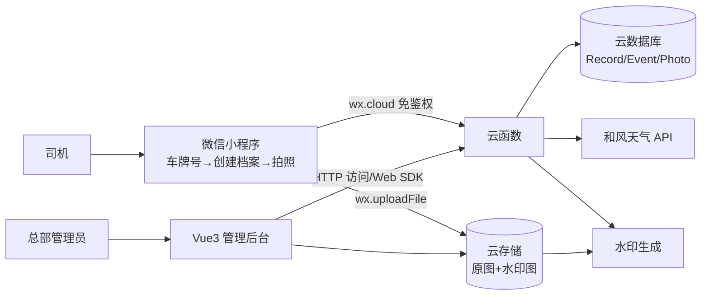

# 技术架构评估（TECHNICAL_ARCHITECTURE）

## 1. 总体推荐架构

```
┌─────────────────────────┐         ┌──────────────────────────────┐
│  司机端（微信原生小程序） │  wx.cloud │  后端（微信云开发 CloudBase） │
│  WXML/WXSS/JS + 原生组件  │ ───────▶ │  云数据库 + 云存储 + 云函数      │
└─────────────────────────┘         │  + 认证（openid） + 水印生成      │
                                    └──────────────┬───────────────┘
                                                   │ HTTP 访问 / Web SDK
┌─────────────────────────┐                        │
│  总部端（Web 管理后台）   │ ───────────────────────┘
│  Vue 3 + Vite + Element Plus │
└─────────────────────────┘
```

- **司机端**：微信原生小程序（满足摄像头、定位权限、分享入口、免安装）。
- **后端**：微信云开发 CloudBase（云数据库 + 云存储 + 云函数 + 云调用），优先推荐。
- **总部端**：Vue 3 + Vite + Element Plus（后台列表与照片展示）。
- **水印**：服务端生成（云函数内使用图像处理，或临时 HTTP 服务），原图与水印图分开存云存储。
- **天气**：和风天气（QWeather）免费版（含「时光机」历史天气），备选 Open-Meteo（免 key）。

## 2. 后端选型对比（重点）

| 维度 | 微信云开发 CloudBase（推荐） | 自建 Node.js 服务器 |
| --- | --- | --- |
| 微信小程序集成 | 原生 wx.cloud，免鉴权（自动 openid） | 需自建鉴权 + token 流转 |
| 域名/HTTPS/备案 | **云调用走私有协议，无需备案域名与 HTTPS 配置** | 必须：已备案域名 + HTTPS 证书 + 后台白名单 |
| 免费额度 | 免费版 0 元/月（约 3000 资源点）；个人版 ¥19.9/月 | 需自购服务器/域名/证书 |
| 运维 | 免服务器运维 | 需维护服务器 |
| 上线速度 | 最快（30 秒建环境） | 较慢（备案通常 7–20 工作日） |
| 数据迁移 | 相对受限，但可导出 JSON/文件 | 完全可控 |
| 我在沙箱的验证能力 | 可写全部云函数代码；需负责人侧部署后联调 | 可本地完整跑通并测试 |

### 结论与权衡

- **主推微信云开发**：最符合「低成本、轻量、快速交付」且天然规避小程序「备案域名 + HTTPS」这一最大上线门槛；司机端免鉴权最省心。
- **关键前提**：云环境归属项目负责人的小程序账号，AI 无法替负责人开通/授权云环境；需要负责人提供小程序 AppID 并开通云开发，AI 输出云函数源码与部署脚本后，由负责人在微信开发者工具内一键部署。
- **自建服务器仅在**「负责人已具备已备案域名 + 服务器，且希望数据完全自控」时作为备选。

## 3. 关键事实核实（截至 2026-11）

- **小程序域名规则**：生产环境 `wx.request / wx.uploadFile / wx.downloadFile` 域名必须 HTTPS + ICP 备案 + 配置到「服务器域名」白名单；开发阶段可在开发者工具勾选「不校验合法域名」。使用**云开发/云托管无需配置通讯域名**（微信私有协议）。
- **CloudBase 定价**：免费体验版 ¥0/月（每账号 1 个免费环境，约 3000 资源点/月）；个人版 ¥19.9/月（40000 资源点/月）；1000 资源点 ≈ ¥1。新用户有免费试用额度。
- **和风天气**：免费订阅每月 5 万次请求（0 元），超出按量（第 1 个 95 万次 ¥0.0007/次）；「时光机」API 属天气和环境分组，**可查历史天气**，支持按经纬度查询。

## 4. 成本评估（估算，需以官方实时报价为准）

> 本项目持续成本主要来自**图片存储 + 后台查看流量**，云函数/数据库量级很小。

假设：20 辆活跃车 × 150 天产季 × 每车日均 10 张照片（货物2+装箱2+运单1+开关门5次）。

| 项目 | 估算 |
| --- | --- |
| 产季照片总量 | 约 30,000 张 |
| 单张压缩后体积 | 原图约 0.3–0.8 MB + 水印图约 0.1–0.3 MB |
| 总存储量 | 约 10–30 GB（随清晰度/压缩策略波动） |
| 云函数调用 | 每张照片约 2–5 次（创建事件/上传/水印/查天气），总量约 10 万级/产季，免费版可能不足 |
| 后台查看流量 | 按查阅频率，外网下行流量另计 |

**建议**：正式投入产季前，建议升级到 CloudBase 个人版（¥19.9/月）或按量付费，避免免费版资源点用尽中断；同时小程序拍照使用「压缩图」以控制存储体积。具体额度需在开通云环境后按官方控制台实际口径核算。

## 5. 天气方案

| 方案 | 免费额度 | 历史天气 | 备注 |
| --- | --- | --- | --- |
| 和风天气（QWeather）推荐 | 5 万次/月 | 支持（时光机 API） | 需注册免费开发者账号，按经纬度查询，国内稳定 |
| Open-Meteo | 免费、免 key | 支持（Historical Weather） | 国外服务，中国境内访问速度/覆盖需实测 |
| 高德/心知 | 有限免费 | 历史天气能力弱或需付费 | 备选 |

**原则**：天气仅作水印辅助信息，失败不阻断上传、不冒充、记录获取状态。若需付费 API，先向负责人说明费用，不擅自开通。

## 6. 微信小程序上线所需条件（负责人需准备）

1. 微信小程序账号（AppID）+ 主体类型（企业/个体工商户/个人；**个人主体无法配置 web-view 业务域名**，本项目不依赖 web-view，个人主体可用，但功能与类目审核有差异）。
2. 选择类目（涉及运输/物流或企业内部工具类目，需按实际经营范围选择并可能需资质）。
3. 若走云开发：开通云环境（免费环境或付费环境）。
4. 若自建后端：已备案域名 + HTTPS 证书 + 后台白名单。
5. 通过微信审核发布（隐私协议、用户隐私保护指引、定位权限用途说明需合规）。

## 7. 主要技术风险清单

| 风险 | 影响 | 应对 |
| --- | --- | --- |
| AI 无法直接操作微信开发者工具/云控制台 | 联调需负责人侧配合 | 输出完整源码 + 分步部署脚本 + 操作手册 |
| 免费资源点不足 | 产季中断 | 提前升级个人版/按量；压缩图片 |
| 图片存储与流量持续成本 | 长期成本上升 | 压缩、按需下载、CDN 策略 |
| 历史天气获取失败 | 水印缺天气 | 降级显示「天气不可用」，不阻断 |
| 弱网/断网上传 | 照片丢失或重复 | 上传队列 + 幂等 + 防重 + 状态明确 |
| GPS 失败 | 水印缺定位 | 明确「定位未获取」+ 可重试，规则与客户确认 |
| 小程序审核 | 上线延迟 | 提前准备隐私指引与类目资质 |
| 云厂商锁定 | 迁移成本 | 云函数内统一封装存储/DB 访问层，数据可导出 |

## 8. 架构图（mermaid）



## 9. 技术选型汇总

| 层 | 选型 |
| --- | --- |
| 司机端 | 微信原生小程序（WXML/WXSS/JS/JSON） |
| 后端 | 微信云开发 CloudBase（云数据库 + 云存储 + 云函数 + 云调用） |
| 后台 | Vue 3 + Vite + Element Plus |
| 水印 | 服务端生成（云函数内 sharp 或 node-canvas 备选） |
| 天气 | 和风天气（时光机历史天气） |
| 逆地理编码 | 和风天气 GeoAPI 或腾讯位置服务（免费额度） |
| 版本管理 | Git + GitHub（需授权） |
